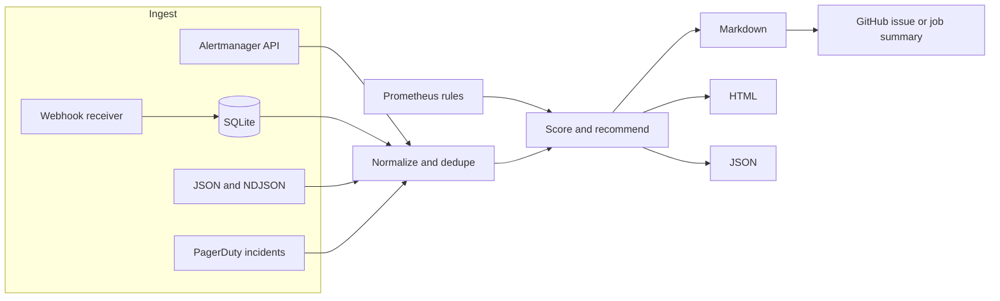

# noisefloor

noisefloor scores a week of Alertmanager history for flapping, volume, and
actionability, then writes a report that says which rules to tune, which to
stop paging on, and which to replace with an SLO burn rate.

Alertmanager tells you what is firing. It does not tell you which rules are
wasting the on-call. noisefloor is the weekly review of that question.

[](https://github.com/gaurangomkar/noisefloor/actions/workflows/ci.yml)

## Why this, now

Alert fatigue is the biggest obstacle to faster incident response in the
[Grafana Labs Observability Survey 2026](https://grafana.com/observability-survey/2026/):
30% of respondents named it, nearly double the next answer. The
[OpsWerks State of SRE Operations 2026](https://go.opswerks.com/sre-report-2026)
found that 63% of teams say fewer than half of their alerts are actionable.
Cloudflare's write-up on
[alerts observability](https://blog.cloudflare.com/alerts-observability/)
describes the practice this tool automates: persist every firing and resolved
notification, then review the noisy rules on a schedule.

A page that clears before anyone acknowledges it, a rule that resolves and
re-fires inside fifteen minutes, and five series of the same condition paging
as five incidents are different problems. They need different fixes. The report
separates them.

## Features

- Ingest current alerts from the Alertmanager API, including silenced and inhibited ones.
- Run a webhook that stores firing and resolved notifications in SQLite, and record acknowledgements against those instances.
- Read JSON and NDJSON exports, including raw Alertmanager webhook bodies.
- Optionally read PagerDuty incidents, where acknowledgement time is real rather than inferred.
- Map each alert back to the Prometheus rule that produced it.
- Score every rule on fire count, flap rate, median and p90 time to resolve, auto-resolve-before-ack, off-hours pages, and overlapping series.
- Recommend tune, mute, or SLO burn rate, with the numbers that justify it.
- Write Markdown, HTML, and JSON.
- Exit non-zero when a noise threshold is exceeded, so CI can fail the week.
- Group by team or any other label, and ignore rules you do not intend to page on.

Sources and report formats are interfaces. Adding one is a package and a registration, described in [docs/extending.md](docs/extending.md).

## Architecture



Alertmanager's API only knows what is active. History comes from the webhook,
an export, or PagerDuty. The API source is still worth turning on: it is the
only one that reports `silencedBy` and `inhibitedBy`, which the webhook payload
does not carry. [docs/architecture.md](docs/architecture.md) covers the collapse
key, the score, and the SQLite schema.

## Install

With Go 1.22 or newer:

```bash
go install github.com/gaurangomkar/noisefloor/cmd/noisefloor@latest
```

Until the first tagged release, `@latest` has nothing to resolve. Install the
branch directly:

```bash
go install github.com/gaurangomkar/noisefloor/cmd/noisefloor@main
```

Release archives for Linux, macOS, and Windows are attached to GitHub releases
by [goreleaser](.goreleaser.yaml). A container image is built from the
[Dockerfile](Dockerfile):

```bash
docker build -t noisefloor .
docker run --rm noisefloor version
```

The image runs as uid 65532. Mount a volume and pass `--user "$(id -u):$(id -g)"`
when the report or the SQLite file has to be written as you.

## Quickstart

The repository ships a pinned week, 23 February 2026 through 2 March 2026, so
this command produces the same report every time. It exits 2 because
`InstanceDown` scores 68 against a threshold of 60.

```bash
git clone https://github.com/gaurangomkar/noisefloor
cd noisefloor
go run ./cmd/noisefloor report --config examples/quickstart.yaml --output out
```

On that sample the action list is:

1. **Tune** `InstanceDown` (platform, score 68.0). 19 of 20 instances re-fired within 15 minutes.
2. **Mute** `PodRestarted` (platform, score 42.2). Every instance cleared before anyone acknowledged it.
3. **Tune** `Edge5xxRate` (edge, score 16.9). All 8 instances overlapped a different fingerprint.
4. **Tune** `CertificateExpiring` (security, score 13.8). All 6 pages started outside business hours.
5. **SLO** `CheckoutLatencyHigh` (payments, score 6.9). 18 fires of a latency symptom, better as a burn rate.

The sentences in `out/noisefloor.md` are longer. They name the `for` duration, the expression, and the burn-rate windows.

`out/noisefloor.html` is the same report for a browser. `out/noisefloor.json`
is the same numbers for a diff or a dashboard.

## Usage

```bash
noisefloor report --config noisefloor.yaml
noisefloor webhook --config noisefloor.yaml
noisefloor version
```

`report` writes the files named in the config and prints one line to stderr.
Exit codes:

| Code | Meaning |
| --- | --- |
| 0 | The report was written and the threshold was not exceeded, or failing on it is disabled. |
| 1 | The config, a source, or the output path failed. |
| 2 | At least one rule scored at or above `thresholds.max_noise_score`, past `thresholds.max_noisy_rules`. |

Flags for `report`:

| Flag | Default | |
| --- | --- | --- |
| `--config` | `./noisefloor.yaml` | Also tries `noisefloor.yml` and `.noisefloor.yaml`. |
| `--output` | `output.dir` | Directory. Relative paths here are relative to the working directory, not the config file. |
| `--formats` | config | Comma-separated `markdown`, `html`, `json`. |
| `--fail-on-threshold` | config | `true` or `false`. |
| `--now` | config, else the current time | RFC3339 end of the window, for a backfill. |
| `--stdout` | off | Also write the Markdown report to stdout. |
| `--verbose` | off | Log how many events each source returned. |

Flags for `webhook`:

| Flag | Default | |
| --- | --- | --- |
| `--config` | `./noisefloor.yaml` | Must set `sources.sqlite.path`. |
| `--addr` | `webhook.addr` (`:8080`) | Listen address. |
| `--verbose` | off | Debug logging. |

### Webhook

Point Alertmanager at the listener with `send_resolved: true`. A flap is a
resolve followed by another firing; without the resolve notification the flap
rate stays at zero. `examples/alertmanager-webhook.yml` is a receiver snippet.

```yaml
receivers:
  - name: noisefloor
    webhook_configs:
      - url: http://noisefloor:8080/webhook
        send_resolved: true
```

`POST /webhook` accepts an Alertmanager webhook body. `POST /ack` records an
acknowledgement so auto-resolve is measured instead of inferred:

```bash
curl -sS -X POST localhost:8080/ack \
  -H "X-Noisefloor-Token: $NOISEFLOOR_WEBHOOK_TOKEN" \
  -H 'content-type: application/json' \
  -d '{"fingerprint":"abc","starts_at":"2026-02-23T15:00:00Z","acked_at":"2026-02-23T15:04:00Z"}'
```

Omit `starts_at` to acknowledge the latest instance of that fingerprint. `GET /healthz` returns `ok`.

Set `webhook.token` or `NOISEFLOOR_WEBHOOK_TOKEN`. With neither, anyone who can
reach the port can write history. The listener checks
`X-Noisefloor-Token` or `Authorization: Bearer`.

The same SQLite file is what `report` reads when `sources.sqlite` is set.
Run the webhook continuously and the report on a schedule.

### Alertmanager API

```yaml
sources:
  alertmanager:
    url: http://127.0.0.1:9093
    include_silenced: true
    include_inhibited: true
```

A firing alert's `endsAt` is Alertmanager's resolve timeout, not a resolution.
noisefloor drops it. Silenced and inhibited alerts still count as fires, and a
rule whose instances are mostly silenced gets a sentence saying so.

Basic auth uses `username` and `password` (or `password_env`). Bearer auth uses
`bearer_token`, `bearer_token_env`, or `bearer_token_file`.

### JSON and NDJSON

`sources.files` accepts:

- a JSON array of alerts, as returned by `/api/v2/alerts`
- one Alertmanager webhook body, or NDJSON of them
- NDJSON of noisefloor events

```json
{"alertname":"InstanceDown","status":"resolved","starts_at":"2026-02-23T15:00:00Z","ends_at":"2026-02-23T15:10:00Z","labels":{"alertname":"InstanceDown","team":"platform"},"acked_at":null}
```

`acked_at: null` means "known to be unacknowledged". Omitting the field means
the source does not know, and the score falls back to the grace window.

### PagerDuty

Uncomment the block and export the token. Incidents are optional; leaving the
block out skips the API entirely.

```yaml
sources:
  pagerduty:
    token_env: PAGERDUTY_TOKEN
    service_ids: ["PSERVICE"]
```

The alert name is the incident title, after a leading `[FIRING:n]` or
`[RESOLVED]` prefix is removed. If the title then starts with a Prometheus-style
identifier (`CheckoutLatencyHigh on payments`), that identifier is the rule
name. Group PagerDuty-only data by `service` instead of `team`. High urgency
counts as a page. Acknowledgement time is the earliest acknowledgement on the
incident.

### Backfill and CI

```bash
noisefloor report --config noisefloor.yaml --now 2026-03-02T00:00:00Z --fail-on-threshold=true
```

`--now` is the end of the window. The start is `now` minus `window`.

## Configuration

Copy [examples/noisefloor.yaml](examples/noisefloor.yaml). Relative paths are
resolved against the config file, not the shell's working directory. Unknown
keys are an error. Durations are strings: `15m`, `168h`, `7d`, `1d12h`.

An omitted key keeps the default. An explicit `0` or `false` is kept, which is
how a weight is turned off.

| Key | Default | |
| --- | --- | --- |
| `window` | `168h` | Half-open window ending at `now`. Maximum 366 days. |
| `now` | current time | RFC3339 end of the window. |
| `timezone` | `UTC` | How times are printed. Business hours have their own timezone. |
| `business_hours.enabled` | `true` | `false` drops the off-hours component instead of scoring it as zero. |
| `business_hours.timezone` | `UTC` | IANA name. |
| `business_hours.days` | Mon–Fri | `mon` or `monday` or `1`. |
| `business_hours.start` / `end` | `09:00` / `17:00` | End is exclusive. A shift that crosses midnight is rejected. |
| `sources.alertmanager` | off | See above. |
| `sources.sqlite.path` | off | Webhook history. Created by `webhook`, not by `report`. |
| `sources.files[].path` | off | JSON or NDJSON. |
| `sources.pagerduty` | off | Absent means the API is not called. |
| `rules.paths` | none | Files, directories, or globs. Recording rules are skipped. |
| `grouping.labels` | `[team]` | One report row per alert name plus these label values. |
| `grouping.fallback` | `unowned` | Used when a grouping label is missing. |
| `ignore.alertnames` | none | Exact alert names. |
| `ignore.name_patterns` | none | Go regular expressions on the alert name. |
| `ignore.matchers` | none | Each matcher is an AND of label equalities. Any matcher drops the instance. |
| `flap.window` | `15m` | A re-fire this soon after resolve is a flap. |
| `scoring.volume_cap` | `30` | Fires at or above this cap saturate the volume component. |
| `scoring.actionable_after` | `10m` | Median time-to-resolve below this raises `short_ttr`. |
| `scoring.auto_resolve_grace` | `5m` | Without ack data, a resolve this fast counts as auto-resolve. |
| `scoring.off_hours_severities` | `page`, `critical`, `high` | What counts as a page. |
| `scoring.count_unspecified_severity` | `true` | A missing severity label counts as a page. |
| `weights.*` | see below | `0` removes that component. |
| `thresholds.max_noise_score` | `60` | A rule at or above this is noisy. |
| `thresholds.max_noisy_rules` | `0` | How many noisy rules are allowed. Zero means any noisy rule exits 2. |
| `thresholds.fail_on_threshold` | `true` | |
| `recommendations.min_fires` | `5` | Below this, the recommendation stays `keep`. |
| `recommendations.tune_flap_rate` | `0.30` | |
| `recommendations.tune_duplicate_ratio` | `0.30` | |
| `recommendations.tune_off_hours_rate` | `0.50` | |
| `recommendations.mute_auto_resolve` | `0.75` | |
| `recommendations.slo_min_fires` | `15` | Also at least `min_fires`. |
| `output.dir` | the config directory | |
| `output.formats` | markdown, html, json | |
| `output.markdown` / `html` / `json` | `noisefloor.md`, `.html`, `.json` | File names, not paths. |
| `webhook.addr` | `:8080` | |
| `webhook.token_env` | `NOISEFLOOR_WEBHOOK_TOKEN` | Empty string disables the env lookup. |

Default weights: volume 1, flap 2, short time-to-resolve 1.5, auto-resolve 2,
off-hours 1, duplicate 1.2.

## How a rule is scored

Instances are collapsed on fingerprint, alert name, and start time, so a firing
notification and the later resolve are one fire. Only instances that started
inside the window count as fires. An instance that started earlier and was
still open counts as carried in: it can explain a flap, and it is not a new fire.

The score is 100 times the weighted mean of these values, each clamped to
[0, 1]. A weight of zero drops that input. `auto_resolve` is dropped when
nothing resolved. `off_hours` is dropped when business hours are disabled.
Each component's points are rounded to two decimals and then summed, so the
table in the report adds up to the score.

| Component | Value |
| --- | --- |
| `volume` | fires / `volume_cap`, capped at 1 |
| `flap` | flaps / fires |
| `short_ttr` | how far the median time-to-resolve sits below `actionable_after` |
| `auto_resolve` | resolved instances that cleared before acknowledgement |
| `off_hours` | off-hours pages / pages |
| `duplicate` | fires that overlapped a different fingerprint / fires |

A flap is a firing that starts within `flap.window` after the previous instance
of the same fingerprint resolved. Overlap is two different fingerprints of the
same rule whose open intervals intersect. That is the "one incident, six pages"
case, usually an expression that still groups by `instance`.

Auto-resolve uses acknowledgement timestamps when any instance in the group has
them (`acked_at`, the `/ack` endpoint, or PagerDuty). Otherwise a resolution
faster than `auto_resolve_grace` counts. The report says which method it used.

Median and p90 use linear interpolation between the nearest samples.

### Recommendations

The first match wins. The others are still written down as extra reasons when
they apply.

1. **mute**, when there are at least `min_fires`, the auto-resolve ratio is at
   least `mute_auto_resolve`, and the flap rate is below `tune_flap_rate`.
   Paging is the wrong severity. Route it to a ticket, or delete it. If the
   expression looks like a symptom, the reason also says to convert it to a
   burn rate instead of muting it outright.
2. **slo**, when the fire count reaches `slo_min_fires`, the alert name or the
   expression looks like a user-facing symptom (error rate, latency, duration,
   availability, 5xx, saturation, timeout), it is not already a burn-rate rule,
   and it is not already in the mute bucket. The suggested page is a
   multi-window burn rate: 5m and 1h at 14.4x, and 30m and 6h at 6x, which is
   the pair from the SRE workbook. Keep the single threshold as a ticket.
3. **tune**, when the flap rate, the overlap ratio, or the off-hours page ratio
   crosses its cutoff, or when the noise score crosses `max_noise_score`
   without one of those cutoffs. The reason names the cutoff and the `for`
   duration when the rule file has one.
4. **keep**, otherwise. A score that is already over the threshold but a sample
   under `min_fires` stays `keep`, and says so, because five flaps out of two
   fires is not a rule change yet. The exit code still fails if the score is
   over the line.

Symptom matching is a heuristic on the name and the expression. It will miss a
cleverly named rule and it will flag a rule whose expression merely mentions
`error`. Read the reason before you rewrite the page.

## GitHub Action

[`.github/workflows/weekly-report.yml`](.github/workflows/weekly-report.yml)
runs every Monday at 13:00 UTC. If `noisefloor.yaml` is in the repository it
builds noisefloor from that checkout, writes the job summary, uploads the
report, and opens an issue titled `Alert hygiene report YYYY-MM-DD`. A second
run on the same day comments on the open issue instead of opening another.
The workflow exits 0 even when the threshold is exceeded, so the issue still
gets posted. Use `report --fail-on-threshold=true` in a separate check when a
noisy week should fail CI.

Other repositories can call the composite action once this repo is public and
the module is fetchable:

```yaml
permissions:
  contents: read
  issues: write

jobs:
  hygiene:
    runs-on: ubuntu-latest
    steps:
      - uses: actions/checkout@v4
      - uses: gaurangomkar/noisefloor/.github/actions/noisefloor@main
        with:
          config: noisefloor.yaml
          version: main
          fail_on_threshold: "true"
          post_issue: "true"
```

Pin `version` to a release tag when you have one. `version: main` tracks this
repository's main branch.

## Development

```bash
go test ./...
go vet ./...
golangci-lint run
```

`UPDATE_GOLDEN=1 go test ./internal/run` rewrites `testdata/golden` after an
intentional change to the score or the wording. Review that diff.

See [CONTRIBUTING.md](CONTRIBUTING.md) for the layout and for good first issues.

## Roadmap

- A Prometheus source that range-queries `ALERTS` and `ALERTS_FOR_STATE`, for teams that never deployed the webhook.
- Opsgenie and Grafana OnCall sources, using the same `Source` interface as PagerDuty.
- A Slack reporter that posts the "do this week" section, not the whole report.
- A week-over-week diff against a previous report JSON.
- Business hours that cross midnight, for follow-the-sun rotations.
- A suggested `for` duration taken from the measured gap between resolve and re-fire, instead of pointing at the flap window.

## License

MIT. Copyright 2026 Gaurang Vishwasrao. See [LICENSE](LICENSE).
