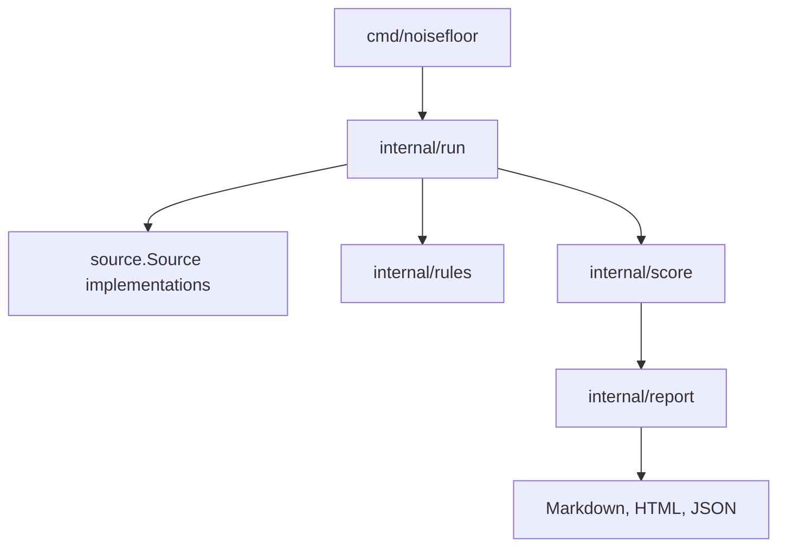

# Architecture

noisefloor is a single binary. `cmd/noisefloor` parses arguments.
`internal/run` loads the config, reads every source, loads rule files, and
calls the scorer. `internal/score` does not do I/O. `internal/report` does not
recompute anything. That split is what keeps a new source from growing a second
copy of the flap math.



## An alert instance

A source returns `model.Event` values. One event is one firing: a fingerprint,
an alert name, a start time, and optionally an end time and an acknowledgement.

Alertmanager sends several notifications for that firing. `source.Collapse`
merges them. The key is fingerprint, alert name, and start time. A resolved
notification wins over a firing one, the earliest acknowledgement is kept, and
silence or inhibition sticks once any notification says so. Two sources that
saw the same firing become one instance, and the source names are joined.

`model.Normalize` fills the alert name from the `alertname` label, builds a
fingerprint from the labels when the source did not send one, and clears
`endsAt` unless the status is `resolved`. A firing alert's `endsAt` in the
Alertmanager API is the resolve timeout, moved forward on each evaluation. Using
it as a resolution makes every active alert look recently resolved.

Events with no `starts_at` are dropped and counted. Events that do not overlap
the window are ignored. The window is half-open: `[now - window, now)`.

## What each source can see

| Source | History | Acknowledgement | Silence and inhibit |
| --- | --- | --- | --- |
| Alertmanager API | Active alerts only | No | Yes, from `silencedBy` and `inhibitedBy` |
| Webhook plus SQLite | As long as the process has been running | Only after `POST /ack` | No. The webhook body does not include them |
| JSON / NDJSON | Whatever the file contains | When `acked_at` is present, including JSON `null` | When the export has the fields |
| PagerDuty | Incidents in the window | Yes, the earliest acknowledgement | No |

`acked_at: null` and a missing `acked_at` are different. Null means the source
knows nobody acknowledged it. Missing means the source cannot tell, and the
score uses the grace window instead.

PagerDuty is constructed only when `sources.pagerduty` is present. There is no
probe of the API on a normal run.

## Rules

`internal/rules` reads Prometheus rule files. A path may be a file, a directory
of `*.yml` and `*.yaml`, or a glob. Recording rules are skipped. A rule that
sets both `alert` and `record` is an error.

Lookup is by alert name. When several groups define the same name, the rule
whose labels agree with the firing labels wins. Ties keep file order. The line
number of the `alert` key is what the report prints, so a tune recommendation
can point at `rules.yaml:31`.

Rules are not required. Without them the score still runs, and the report says
it could not cite an expression.

## Grouping

A row is an alert name plus the configured grouping labels, `team` by default.
A missing label becomes `grouping.fallback` (`unowned`). Two teams firing the
same alert name are two rows, which is what you want when the rule is shared
and the noise is not.

`ignore` is applied before grouping. An alert name, a name pattern, or a label
matcher drops the instance. Matchers are AND inside one matcher and OR across
matchers.

## Flaps, overlap, time to resolve

Within a row, instances are sorted by fingerprint and start time.

A later instance is a flap when the previous one resolved and the gap from that
`endsAt` to the new `startsAt` is between zero and `flap.window`, inclusive of
both ends. The previous instance has to be in the set being scored, so it must
overlap the window. A resolve that finished before the window started does not
create a flap. Carried-in instances, those that started before the window and
were still open during it, are not fires. They do participate in flap detection.

Overlap is a different fingerprint of the same row whose interval intersects
this one. Open instances are treated as open until the end of the window.
Same-fingerprint overlap is not counted; that is one series, not two pages.

Time to resolve is `endsAt - startsAt` for resolved instances. Median and p90
interpolate linearly between the surrounding samples. `short_ttr` is zero when
nothing resolved, and otherwise
`(actionable_after - median) / actionable_after`, clamped to [0, 1]. A median
of one minute against a ten-minute `actionable_after` is 0.9. A median of
twenty minutes is 0. Long resolves show up as a p90 sentence, not as score,
because a page that stays firing is a different failure from a page that
flaps.

## Auto-resolve and off-hours

If any instance in the row has `AckKnown`, the ratio is taken over resolved
instances with known ack state. An instance counts as auto-resolved when it
was never acknowledged, or when `ackedAt` is at or after `endsAt`.

If none of them have ack state, the ratio is the fraction of resolved instances
whose duration is at most `auto_resolve_grace`. The report labels this `grace`
so it is not mistaken for a measured acknowledgement.

Off-hours uses the start time in `business_hours.timezone`. The day must be
listed, and the local clock must be in `[start, end)`. A page is an alert whose
severity is in `off_hours_severities`, or an alert with no severity when
`count_unspecified_severity` is true. The ratio is off-hours pages divided by
pages. A warning that never pages contributes zero, which is what you want.

## Score

```text
score = 100 * sum(weight_i * value_i) / sum(weight_i)
```

Values are clamped to [0, 1] before the weights are applied. The reported
points for each component are rounded to two decimals, and the score is the
sum of those points. Rounding is part of the result, not a display choice: the
threshold compares the same number the report prints.

Default weights, in the order they are computed: volume 1, flap 2, short_ttr
1.5, auto_resolve 2, off_hours 1, duplicate 1.2. The report sorts the table by
points so the largest contributor is first.

`volume` is `fires / volume_cap`, capped at 1. It stops a single chatty rule
from outranking a rule that is on fire in every other way, and it stops a
quiet rule with one flap from scoring like an outage.

## Recommendations

`internal/score/recommend.go` applies the first matching rule:

1. mute, when the sample is large enough, auto-resolve is high, and the flap
   rate is not itself over the tune cutoff
2. slo, when the sample is large enough for an SLO call, the name or the
   expression matches the symptom pattern, the rule is not already a burn
   rate, and auto-resolve is below the mute cutoff
3. tune, when flap, overlap, or off-hours crossed a cutoff, or the score
   crossed `max_noise_score`
4. keep

Extra reasons are appended: a silenced majority, instances still firing,
carried-in instances, a p90 of six hours or more, and a missing rule file.
The symptom pattern and the burn-rate pattern are the regular expressions in
that file. They are deliberately blunt.

The exit code does not use the recommendation. It uses the score and
`thresholds.max_noisy_rules`. A rule can be "mute" and still under the score
threshold, which is a suggestion rather than a failed build. A rule can be
"keep" because the sample is tiny and still fail the build because the score
is already over the line.

## SQLite

The webhook stores one row per instance.

```sql
CREATE TABLE events (
  fingerprint TEXT NOT NULL,
  alertname   TEXT NOT NULL,
  starts_at   TEXT NOT NULL,
  ends_at     TEXT,
  status      TEXT NOT NULL,
  labels_json TEXT NOT NULL,
  annotations_json TEXT NOT NULL,
  generator_url TEXT,
  receiver    TEXT,
  source      TEXT NOT NULL,
  acked_at    TEXT,
  ack_known   INTEGER NOT NULL,
  silenced    INTEGER NOT NULL,
  inhibited   INTEGER NOT NULL,
  updated_at  TEXT NOT NULL,
  PRIMARY KEY (fingerprint, alertname, starts_at)
);
```

Times are RFC3339 nanoseconds in UTC. Upsert keeps a resolved status once one
notification has it, and it keeps the earliest acknowledgement. The file is
ordinary production data: labels and annotations often contain hostnames and
customer identifiers.

## Report JSON

`scorer_version` is `"1"`. Readers that store reports should ignore unknown
fields and refuse a version they do not understand rather than guessing. The
Markdown and HTML renderers are views of this struct. They do not score.
